  

  
  
  

  

<h3 align="center">⚡ Featured builds</h3>

<table align="center">
  <tr>
    <td></td>
    <td></td>
  </tr>
  <tr>
    <td></td>
    <td></td>
  </tr>
</table>

<h3 align="center">🧩 Claude Skills I built</h3>

Drop-in Agent Skills for Claude Code, Claude.ai & the API

  
  
  

<h3 align="center">🧰 Arsenal</h3>

  

<h3 align="center">📈 Activity</h3>

  <picture>
    <source media="(prefers-color-scheme: dark)" srcset="https://raw.githubusercontent.com/shahab7e/shahab7e/output/pacman-contribution-graph-dark.svg" />
    
  </picture>

  
  

