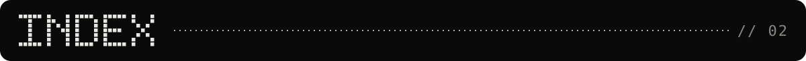
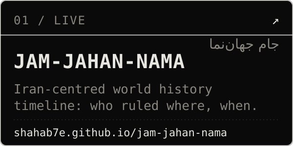
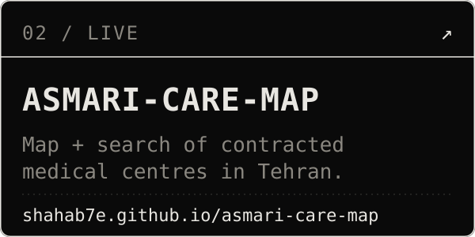
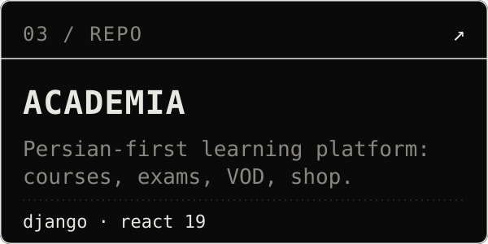
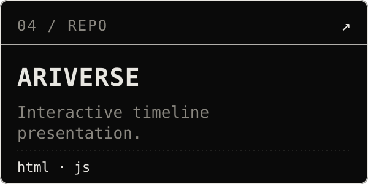

  

  
  
  
   
  <b><a href="https://github.com/shahab7e/Gommage">Source</a></b> · <b><a href="https://github.com/shahab7e/Gommage/releases/latest">Download</a></b>

  
  
  
  

  
  
  

  <picture>
    <source media="(prefers-color-scheme: dark)" srcset="https://raw.githubusercontent.com/shahab7e/shahab7e/output/pacman-contribution-graph-dark.svg" />
    
  </picture>

  

